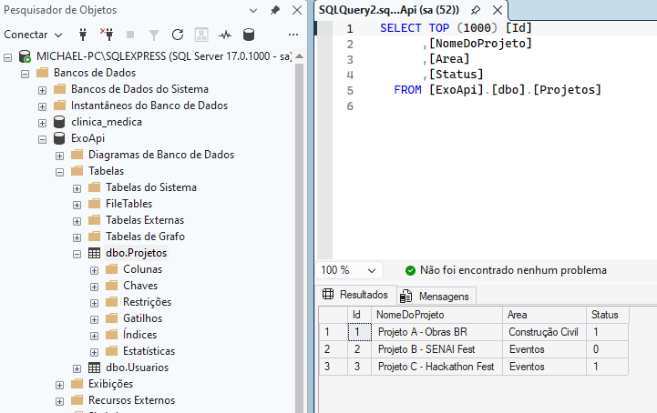
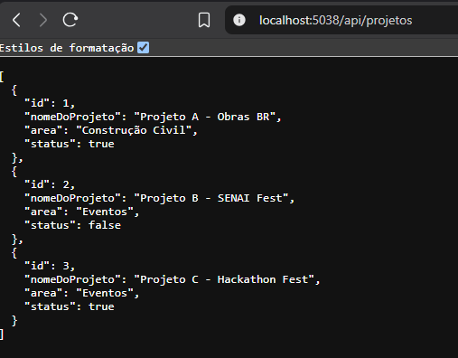

# Exo.WebApi — Listagem de Projetos (`GET /api/projetos`)

API REST desenvolvida em C# / .NET para o projeto **ExoApi** (Atividade 3 — Desenvolvimento de APIs, SENAI), integrada ao **SQL Server** via **Entity Framework Core** para consulta de projetos cadastrados.

## Funcionalidades e Estrutura

* **`Models/Projeto.cs`**: Define a entidade `Projeto` com as propriedades `Id`, `NomeDoProjeto`, `Area` e `Status`.
* **`Contexts/ExoContext.cs`**: Configura o `DbContext` (`DbSet<Projeto> Projetos`) e a string de conexão com a instância do SQL Server e o banco `ExoApi`.
* **`Repositories/ProjetoRepository.cs`**: Implementa o acesso a dados e o método `Listar()` para retornar os registros da tabela `Projetos`.
* **`Controllers/ProjetosController.cs`**: Expõe o endpoint `GET api/projetos` (`Listar()`) devolvendo os dados em formato JSON.
* **`Exo.WebApi.csproj`**: Define a estrutura e o `TargetFramework` do projeto para execução no ambiente .NET instalado.

## Banco de Dados

1. Abra o script `cria-db.sql` (localizado na pasta `Material-Aluno` do material da atividade) no **SQL Server Management Studio (SSMS)** e execute-o para criar o banco `ExoApi`, a tabela `Projetos` e inserir os registros iniciais.
2. Confirme no **Pesquisador de Objetos** do SSMS que o banco `ExoApi` e a tabela `Projetos` foram criados com os dados cadastrados.
3. Ajuste a string de conexão em `Contexts/ExoContext.cs` conforme o servidor/instância do SQL Server (por exemplo, `MICHAEL-PC\SQLEXPRESS`) e o tipo de autenticação utilizado.
4. Antes de publicar em um repositório público no GitHub, remova ou substitua senhas reais por valores genéricos/exemplos ou utilize autenticação integrada do Windows.

## Como Executar

1. Abra a pasta `Exo.WebApi` no terminal ou no **VS Code** e verifique a versão do .NET instalada:
   ```bash
   dotnet --version
   ```
2. Caso necessário, ajuste o `<TargetFramework>` no arquivo `Exo.WebApi.csproj` para uma versão compatível com o runtime instalado na máquina.
3. Restaure os pacotes e compile o projeto:
   ```bash
   dotnet restore
   dotnet build
   ```
4. Inicie a aplicação:
   ```bash
   dotnet run
   ```
5. Acesse no navegador a URL exibida no terminal acrescida do sufixo `/api/projetos` (por exemplo, `http://localhost:5038/api/projetos` ou `https://localhost:7154/api/projetos`) para visualizar o retorno JSON da API.

## Banco de Dados



## API em Execução


